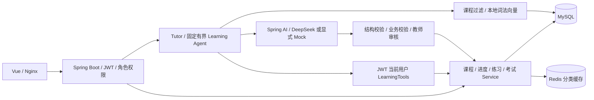
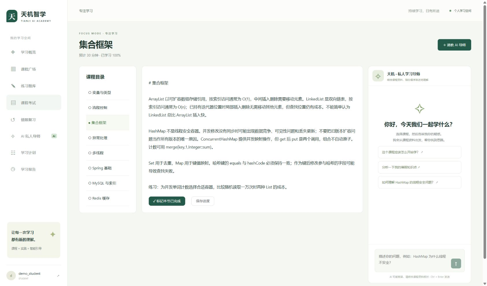

# Tianji AI Academy · 天机智学

围绕课程学习、练习考试、错题与学习计划构建的 Java 智能学习平台。AI 通过受控工具读取学习事实并辅助解释和规划，最终成绩、权限、防作弊和正式题目发布由后端与教师审核约束。

## 1. 项目简介

学生可完成课程、记录进度、练习和考试，再基于真实学习记录使用 Tutor、错题解释、周报和有界学习计划。教师审核 AI 题目草稿与简答评分建议，模型不能直接改正式成绩。

历史已验证有限真实 DeepSeek API 场景；默认课程检索是本地词法向量，远程神经 Embedding 未验收。本次文档验收只编辑独立本地候选文档，没有运行已有服务或付费请求。

## 2. 技术栈

| 层 | 已使用技术 |
| --- | --- |
| 后端 | Java 17、Spring Boot、JWT、BCrypt、MyBatis-Plus、Spring AI、Flyway |
| 存储 | MySQL、Redis 分类缓存 |
| AI | DeepSeek-compatible Provider、Tool Calling、Memory、结构化输出、SSE、词法 RAG |
| 前端 | Vue 3、JavaScript、Vite、Pinia、Element Plus |
| 工程 | Maven 多模块、JUnit/Mockito、H2 单测、真实数据库专项、Docker Compose |

实际认证实现见源码；项目使用 JWT 与角色授权，不将其包装成完整生产 IAM。

## 3. 系统架构



Learning Agent 为 Java 固定有界流程，不是 Multi-Agent 或无限自主循环；没有已实施的消息队列。

## 4. 核心功能

| 能力 | 源码入口 |
| --- | --- |
| 课程、学习进度、练习、考试与错题 | [后端业务](tj-server/src/main/java/com/tang/tianji/) |
| 当前用户学习记录工具 | [LearningTools](tj-server/src/main/java/com/tang/tianji/ai/tool/LearningTools.java) |
| 固定有界学习计划 | [LearningAgent](tj-server/src/main/java/com/tang/tianji/ai/agent/LearningAgent.java) |
| Tutor、结构化结果与词法向量 | [AI](tj-server/src/main/java/com/tang/tianji/ai/)、[LexicalEmbeddingConfig](tj-server/src/main/java/com/tang/tianji/ai/config/LexicalEmbeddingConfig.java) |

## 5. 关键工程实现与源码位置

- **模型不能读取任意学生信息。** LearningTools 不接受模型传入的 userId，从后端身份上下文读取当前用户；Memory 按用户、会话、课程区分。课程资料先按课程和向量模型过滤，再做检索。
- **AI 计划需要落到合法业务对象。** LearningAgent 查询进度、考试、错题、掌握度及课时，生成后校验日期、时长和课时归属，再保存计划；没有把模型自然语言直接当作数据库写入权限。
- **AI 建议不能替代正式成绩。** AI 题目保持待审核，简答评分保持 NEEDS_REVIEW；考试进行中由后端状态拦截学习辅助请求。SSE 使用真实模型增量，并在最终结构失败时报告错误，不能把截断 JSON 保存为成功。

## 6. 本地部署教程

需要 JDK 17、Maven 3.9+、Node.js 20.19+、MySQL 8、Redis，使用独立库 `tianji_ai_academy`。新环境建库后由 Flyway 应用迁移，不手动重复逐表导入。

在终端安全设置 `DB_PASSWORD`、`DB_HOST`、`DB_PORT`、`DB_NAME`、`DB_USERNAME`；`JWT_SECRET` 使用随机值。新的开发目录可按以下方式启动，已有环境不重复 seed：

```powershell
mvn package
./scripts/start-dev.ps1
```

另开终端进入 `tj-web`，执行 `npm ci`、`npm run dev -- --host 127.0.0.1`。代理目标用服务端 `API_PROXY_TARGET` 指定；端口以启动终端输出为准。开发数据需显式 `DEMO_PASSWORD` 和 seed 开关，不能当作生产账号。

AI 默认关闭。`AI_ENABLED=true`、`AI_MODE=mock` 仅提供明确标注的 Tutor 演示，不支持全部真实结构化能力；真实模式需自行注入 `AI_API_KEY`，本次文档验收未运行该入口。Docker 用 [init-env](scripts/init-env.ps1) 在新目录生成独立配置，再按 [完整原部署说明](docs/history/README.before-portfolio-20261018.md) 执行；历史 Docker 运行验收仍被 WSL 引擎问题阻塞。

## 7. 真实运行截图



截图来自既有真实 MySQL 开发环境，不代表本次文档验收真实 AI 浏览器流程完成。旧 `dashboard.jpg` 属于 H2 阶段，不能作为 MySQL 验收截图替换使用。

## 8. 测试结果与已知限制

| 验证 | 已有结果与范围 |
| --- | --- |
| 2026-10-04 历史发布普通后端 | 45 项中 44 通过、1 项真实 MySQL 可选测试跳过；模型为 Mock |
| 2026-10-04 历史前端 | 4 项及构建通过 |
| 历史 HTTP | 39 项，记录当时 AI 关闭；不作为真实模型证明 |
| 2026-10-04 历史真实 AI | Tutor、Tools、Memory、计划、题目草稿、周报、评分建议与取消等有限 API 场景，有独立记录 |
| 本次文档验收 | 仅文档与链接/图检查；没有重新运行业务、浏览器或付费模型测试 |

```powershell
mvn test
cd tj-web
npm test
npm run build
```

真实 MySQL 专项需要独立数据库并显式启用 `RUN_REAL_DB_TESTS`。尚未完成真实 AI 的 Chrome 完整交互、远程神经 Embedding、Docker 运行和系统模型质量评测。既有测试摘要中的旧数字与 AI 未启用状态属于早期时点，当前文档以逐项记录为准。

[本次文档验收记录](docs/PORTFOLIO_VERIFICATION.md) · [真实 AI 验收](docs/REAL_AI_VERIFICATION.md) · [架构](docs/ARCHITECTURE.md) · [面试问题](docs/INTERVIEW.md) · [原 README](docs/history/README.before-portfolio-20261018.md)

源码采用 [MIT License](LICENSE)，第三方依赖保留各自许可证。

[本地验收记录](docs/LOCAL_ACCEPTANCE.md) · [测试证据及版本索引](docs/TEST_EVIDENCE.md)
