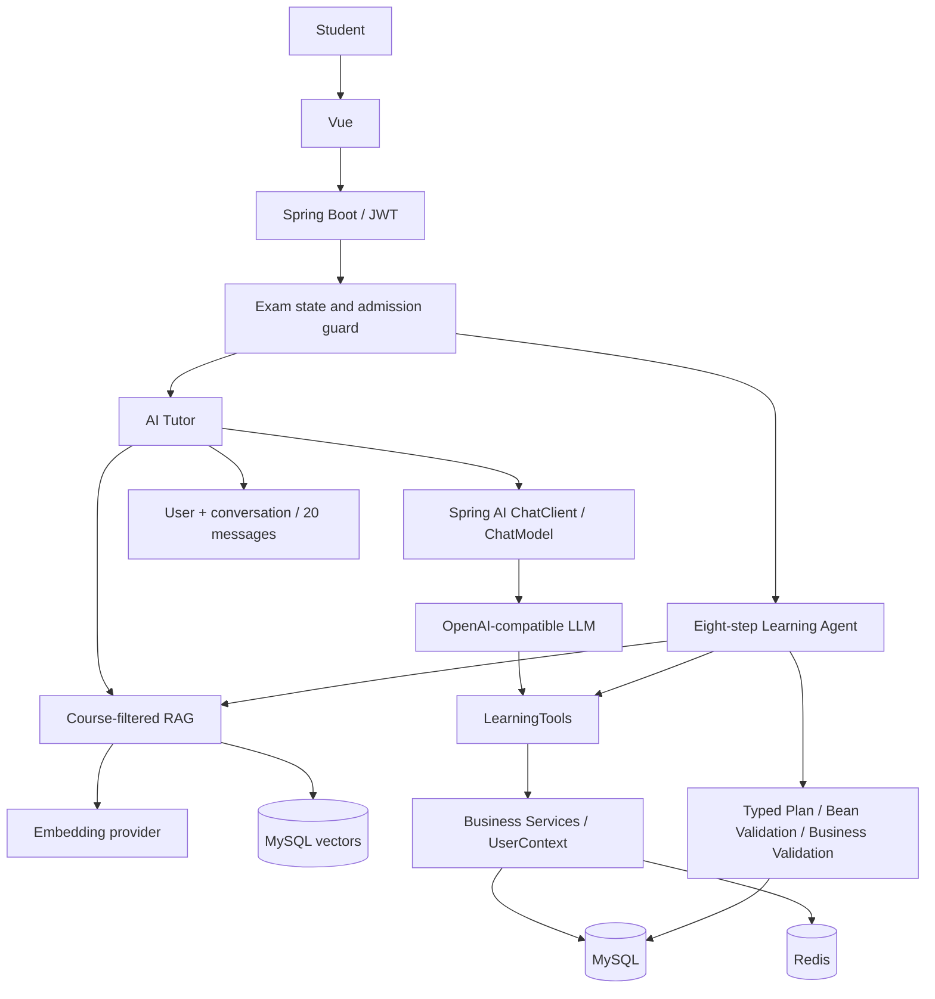

# AI 架构与真实验证边界

## Provider

生产代码直接使用 Spring AI ChatModel 与 EmbeddingModel，测试中才由 Mockito 替代。AI_ENABLED 默认 false。聊天/向量分别配置 base-url、api-key、model。HTTP 连接10秒、读取30秒，流45秒超时，AI任务90秒超时，工作线程池4且无排队积压。调用日志只存请求ID/用户/模型/耗时/工具次数/状态，不存密钥。

## RAG

八份 Java 课程文档不是检索假字符串。教师导入后生成900字符窗口、700步长分块，保存 courseId/chapterId/lessonId/teacherId/title/source/content/model/vector。先在 SQL 层限制 courseId 和 embeddingModel，再计算余弦相似度，阈值0.25，Top-5。单课程上限2000块。相同课程相同source原子替换，失败保留旧资料。检索文档是数据，不是指令。

真实 MySQL 未导入伪向量；缺少 Embedding 密钥，所以目前真实检索质量待验收。H2 + Mock Embedding 的课程隔离测试通过，只证明程序过滤与持久化路径。

## Tool Calling 与 Memory

Tutor 使用 ToolCallingManager 执行模型返回的调用，最多8次工具与8轮处理，调用批次超额前拒绝。七工具无 userId 参数，从 JWT → DB 当前角色 → UserContext 取身份。MySQL 只读集成测试已真实验证七个工具；“模型是否正确选工具”仍需真实供应商验证。

推荐课时按低于60%正确率知识点与课时标题匹配排序，未完成次之、已完成复习最后。这是可解释规则，不是训练出的推荐模型。

Memory 唯一键(user_id,conversation_key)，同时校验courseId，保留最近20条消息；不同用户同名会话不共享。真实两轮语义承接“复习集合 → 给我5道题”仍需真实模型验收。

## Structured Output

GeneratedQuestions/GeneratedQuestion、TutorAnswer、AiGradingResult、WeeklyLearningReport、PlanOutput（StudyPlan持久化前的DTO）、PlanDay、教师草稿均通过 Spring AI 转对象，再 Jakarta Validation；计划另校验连续日期、用户预算和真实课时白名单，分数另核对题目满分。

Tutor 的模型 JSON 流先缓冲，BeanOutputConverter 转 TutorAnswer，校验后才写 Memory 和发 answer/delta/suggestions/done。此选择避免把残缺JSON展示成成功答案，代价是正文不逐token显示；状态事件依旧实时。来源由Java检索，模型不能自行生成不存在的来源记录。

## Agent / AI 评分 / 教师

Agent 是8步可观察业务流程，读取进度、考试、错题、掌握度、课程资料、可用课时，然后生成、校验、保存。前端日卡包含日期、主题、课时、练习量、复习点和分钟数。steps 是完成后的业务轨迹；没有模拟进度动画或展示隐藏思维链。

AI题状态 AI_GENERATED，教师确认 APPROVED 后才允许组卷。教师大纲/FAQ 为草稿，不自动发布。客观评分只用Java，AI简答建议所有置信度均 NEEDS_REVIEW，教师最终确认。

## 安全和质量

考试 IN_PROGRESS 时 guard 后端拒绝AI与练习/错题答案，注入“忽略规则”无法绕过状态检查。AI仅解释Java统计，不负责基础数值计算。提示词降低注入/幻觉风险，但不构成完整防护，仍需人工核对引用、统计与建议。

真实验收脚本 `scripts/verify_ai.py` 会导入真实讲义并执行六个Tutor问题、计划、出题、报告与错题分析。它只自动检查传输/结构/持久化，最终事实准确性和Memory语义必须人工检查，不能把脚本PASS当全部AI质量合格。
