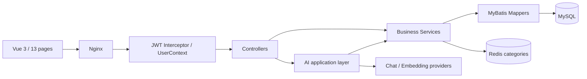

# 系统架构

采用多模块单体，便于本科项目解释与运行；没有引入微服务或强行 DDD。Controller 做输入验证和调用编排，Service 控制授权/事务/状态转换，Mapper 参数化查询。ExamService 较长，集中保留考试状态、确定性判分和复核不变量；将来可按组卷与评分拆分，但当前不跨边界复制逻辑。

## 数据

22 张业务表：用户/教师，课程/章节/课时，学习记录/事件，知识点/题目/关联，考试/题目/记录/答题，错题/收藏，计划/日卡，会话/消息，知识块、AI调用日志。另有 Flyway 元数据表。

用户与课时唯一键防重复学习记录，用户与题目唯一键防重复错题条目。V2 对最近学习、考试状态、答题时间、会话消息、课程来源、课程分类补充复合索引。真实 MySQL 验收统计为 82 个索引、22 个外键、9 个唯一约束（含主键另计）。不改 V1/V2 校验和。

## 并发与事务

学习心跳、考试开始/提交、AI admission 和教师复核在事务中锁定当前用户行。提交已完成考试返回原结果，避免再次计分。新增课时与课程课时数一起提交。AI 工作线程显式接收身份，finally 清理 ThreadLocal。AI admission 内存集合只支持单实例；多实例必须改为数据库租约或 Redis 分布式锁，不能仅靠提示词。

MySQL 为权限/分数/进度事实来源。Redis 缓存仅分类，独立前缀和五分钟 TTL，Service 写入后失效；异常回源会记录告警。写后删除仍有并发旧读回填窗口，不声称强一致。

## 查询质量与边界

知识掌握度从每个知识点单独查询改成批量关联查询；教师错题和薄弱点改为 JOIN + GROUP BY。新错题详情批量加载题目、答案和知识点，但课程访问检查仍逐错题执行，可进一步按课程去重。掌握度当前读取个人历史答题，数据规模变大需要滚动统计或分页。

列表有部分固定上限（课程100、题库200、单课程向量2000）；这是第一版容量边界，不是完整分页系统。RAG 导入事务包含 Embedding 网络调用，后续可分离外部计算与短保存事务。题库答案只在本人练习反馈/错题详情等允许的路径展示；错题详情在考试期间拒绝。
