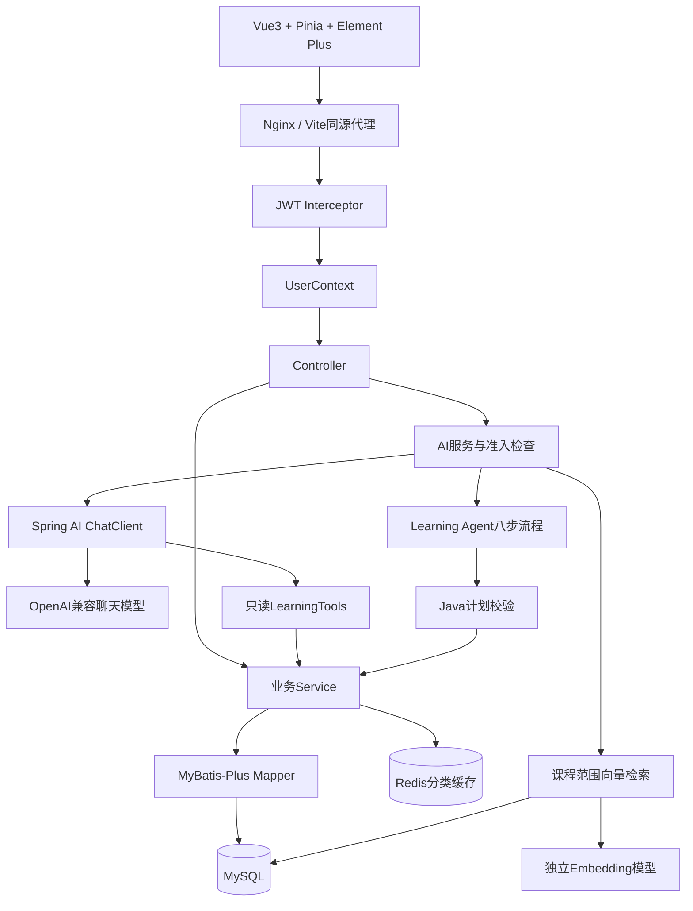

# 架构与数据流

## 选择多模块单体

第一版优先建立可验证业务闭环。三个 Maven 模块共享一次事务边界，避免过早引入服务发现、分布式事务和消息队列。包名统一为 `com.tang.tianji`。

## 身份与事务

JWT 只携带服务签发的用户标识，每次请求从数据库读取当前角色。学生资源均使用 `UserContext.getCurrentUserId()`，不从请求体读取用户ID。异步 AI 工作显式捕获并恢复 Principal，结束时清理 ThreadLocal。

考试开始、提交、练习和学习心跳通过 `SELECT app_user ... FOR UPDATE` 串行化同一用户的重要写操作。正式考试一次只能有一份处于 `IN_PROGRESS`；提交后重试返回已有结果，不重复写入答题和错题。过期提交整卷为0并标记 `EXPIRED`；前端保留显式提交入口，不自动替用户交卷。

AI 准入也先获取用户行锁，再检查考试状态并标记本进程正在执行。考试开始检查同一个准入标记，避免“先开始AI、再开始考试”竞态。当前设计限定单后端实例；多实例前需改为数据库或Redis租约。

## RAG 实现

1. 验证教师拥有课程，章节/课时确实属于课程。
2. 对资料按900字符窗口、700字符步长分块，记录课程、章节、课时、教师、标题和来源。
3. 通过 Spring AI `EmbeddingModel` 生成向量，保存到 MySQL `knowledge_chunk.embedding`。
4. 对同一课程和同一来源原子替换；失败回滚保留旧资料。
5. 查询先限定 `course_id + embedding_model`，然后计算余弦相似度，返回最多5个来源。
6. 将资料作为不可信用户数据放入上下文，系统规则不拼接资料内容。来源列表来自后端检索结果。

这是自实现的小规模持久向量库，使用精确扫描，不依赖 MySQL 原生向量索引。每课程上限2000分块；大规模场景应替换为支持元数据过滤的专用向量存储。中文分块按字符切分，尚无语义分段、重排或离线检索质量基准。

## 工具与流式对话

导师先进行有界工具准备阶段，由 Spring AI 生成工具调用、Java `ToolCallingManager` 执行；任何批次超过剩余预算会在执行前拒绝。最多8次调用和8次模型准备步骤。最后再发起一次无工具的模型流式生成，把真实文本片段通过 SSE 发给前端。这样工具不会在最终流式阶段继续无限执行，代价是多一次模型生成请求。

学生工具实例按本次已授权课程绑定，方法没有 `userId` 参数。所有查询沿 Tool → Service → Mapper 执行，不提供SQL工具。教师工具仅返回自有课程汇总，不返回学生名单。

SSE 事件：`status`、`sources`、`delta`、`suggestions`、`done`、`error`。前端使用 fetch 读取 POST 响应，带 Bearer 头，支持 AbortController、错误与90秒超时。文本按纯文本显示，无HTML执行。建议问题当前为固定教学提示，不伪装成模型生成结果。

## Memory 与 Agent

会话键为数据库中的 `(user_id, conversation_key)`，创建时绑定课程。只保留最近20条消息（10轮），完整成功回复才写入历史。重用他人的会话键会创建自己的独立会话，不能读取他人的记录。当前前端在页面生命周期内保留消息，尚无历史会话恢复界面。

Agent 是可观察的确定性工作流：进度 → 考试 → 错题 → 掌握度 → 检索与真实课时 → 结构化计划 → Java验证 → 保存。校验包括日期连续性、天数、每日分钟上限、练习数量和课时白名单。展示的 `steps` 为业务执行步骤，绝不展示内部思维链。

## 缓存与降级

仅课程分类列表采用 Spring Cache / Redis Cache Aside，TTL 5分钟；课程修改和状态变更清除缓存。Redis不可用时回源数据库，分类短暂陈旧不影响权限。课程详情每次实时检查数据库发布状态与归属，避免缓存绕过下架权限。

模型未启用或异常，基础学习流程仍独立运行。最多4个AI工作线程、无等待队列、每用户1个并发AI任务；普通AI请求上限90秒，同步模型HTTP读取上限30秒。导入大资料超时可分文件重试。调用日志记录元数据，不保存密钥、JWT和原始提示词。
