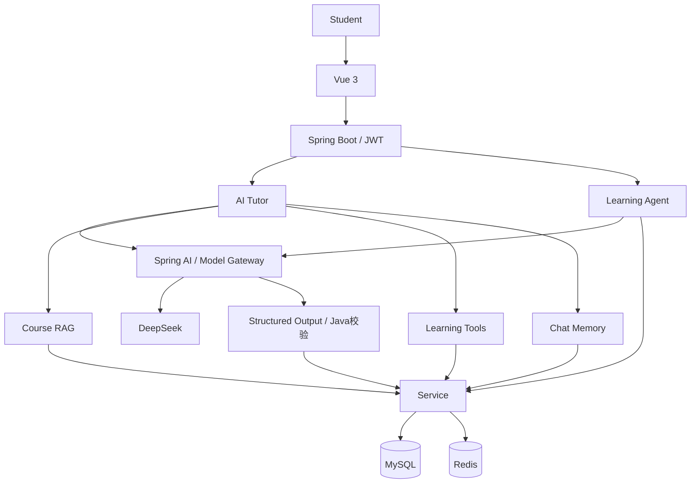

> 历史 README：2026-10-18 中文作品集整理前的原内容。仅调整相对文件链接以适应归档目录；历史状态不代表当前验证。

# Tianji AI Academy · 天机智学

基于 Spring Boot + Vue3 + Spring AI + DeepSeek 构建的 AI 原生智能学习平台。

围绕课程、章节和课时学习，提供进度跟踪、题库练习、考试、错题本和学习报告；AI 使用真实学习记录辅助讲解与规划。

**当前状态：真实 DeepSeek 已接通。** Tutor、工具调用、Memory、计划、题目草稿、错题讲解、周报和简答题建议已取得真实 API 结果。Chrome 本轮完整操作验收仍待连接；Docker 运行验收仍保留原有限制。逐项证据见 [真实 AI 验收](../../docs/REAL_AI_VERIFICATION.md)，不将本地词法向量称为神经 Embedding。

## 验证结果与截图

- 发布前后端45项普通测试：44通过、1项真实MySQL可选测试跳过；前端4项测试及构建通过。另1项显式真实MySQL只读工具测试通过；本轮AI证据单独记录。
- 最新真实 HTTP 回归 39 项通过，报告在 [mysql-http-verification.json](../../docs/mysql-http-verification.json)。最终计数以报告为准。
- MySQL 8.0.44 空库自动应用 V1、V2；共 22 张业务表和 1 张 Flyway 表、82 个索引、22 个外键、9 个唯一约束。
- Redis 3.0.504：真实回填、命中、修改课程后失效；前端 build 通过。
- 浏览器完成登录、读课、完成课时、练习、考试、错题。四题三对一错，实际得分 30/40。
- [完整验收](../../docs/VERIFICATION.md) · [最终报告](../../docs/FINAL_REPORT.md) · [真实环境审计](../../docs/REAL_WORLD_AUDIT.md)


更多截图：`docs/screenshots/mysql-dashboard.jpg`。旧 `dashboard.jpg` 是上一阶段 H2 截图。

## 功能和技术栈

主要页面：登录、首页、课程广场、详情、学习、练习、考试、错题、Tutor、计划、周报、教师、管理员。

JWT + BCrypt + 三角色权限；课程/章节/课时/收藏；学习心跳和进度；Java 客观题评分与幂等交卷；简答题教师确认；错题与知识点统计；RAG、Tools、Memory、AI 出题/周报/备课草稿与有界学习计划。

Java 17、Spring Boot 3.4.13、MyBatis-Plus 3.5.12、Spring AI 1.0.9、MySQL 8、Redis、Flyway；Vue 3、Vite 6.4.3、Pinia、Element Plus。版本固定于 Maven POM 和 npm lockfile。

架构：Vue → JWT 拦截器 → Controller → Service → Mapper → MySQL；Redis 缓存课程分类；AI 应用通过业务工具访问当前用户数据。`tj-common` 为通用结果/异常/身份，`tj-pojo` 为模型，`tj-server` 为业务与 AI，`tj-web` 为前端。

## AI 能力与架构

真实 DeepSeek API 已验证，详见 [REAL_AI_VERIFICATION.md](../../docs/REAL_AI_VERIFICATION.md)。

- **AI Tutor / 课程 RAG**：检索当前课程讲义并解释知识点，提供来源；默认本地词法向量，远程神经 Embedding 未验证。
- **Learning Tools / Chat Memory**：七个工具访问 JWT 当前用户的 MySQL 学习数据，会话按用户、课程和会话隔离。
- **Structured Output**：Tutor、题目、计划、评分建议和周报均通过 Java 字段与业务校验。
- **AI 自动出题 / 错题解析 / 学习报告**：题目保持待审核；简答评分只是建议，最终成绩由教师确认。
- **Learning Agent / SSE**：实际业务步骤实时发送，模型正文按实际增量显示，支持错误和取消处理。
- **考试防作弊**：后端读取 ExamRecord 状态，在调用模型之前拦截进行中考试的学习辅助请求，不只依赖 Prompt 拒绝。



### Learning Agent

示例目标：“根据我最近的考试、错题和学习进度，分析我 Java 哪些知识点最薄弱，并给我制定未来 7 天每天 2 小时的学习计划。”

Java 编排固定且有界的流程：接收目标 → 查询进度 → 查询考试 → 查询错题 → 统计薄弱知识点 → 检索资料与推荐课时 → DeepSeek 生成计划 → Java 验证日期、预算和课时权限 → 保存个人 StudyPlan。它不是无限循环的自主代理。

**职责边界**：LLM 负责自然语言理解、生成、解释与规划；Java 负责身份、权限、真实数据、统计、考试判分、数值范围、计划合法性、防作弊和最终业务约束。模型不能自行选择其他用户、修改正式成绩或绕过审核。

### 项目目录

```text
tj-common/   通用结果、异常、用户身份
tj-pojo/     实体、请求与结构化输出
tj-server/   业务、AI、MySQL迁移与测试
tj-web/      Vue前端
knowledge/   课程知识文档
scripts/     启动与显式验收脚本
docs/        架构、接口、验收和截图
```

## Quick Start：本机 MySQL 开发启动

前置环境：Java 17、Maven 3.9+、Node.js 20.19+（或22.12+）、MySQL 8、Redis。使用独立数据库 `tianji_ai_academy`；已有本机数据库无需重新创建，禁止把连接指向其他项目库。

先自行在启动终端设置 `DB_PASSWORD`，不写入源码、命令历史或聊天。已设置则沿用。使用交互读取可避免明文录入命令历史：

```powershell
$secret = Read-Host 'MySQL password' -AsSecureString
$env:DB_PASSWORD = [System.Net.NetworkCredential]::new('', $secret).Password
$env:DB_HOST = '127.0.0.1'
$env:DB_PORT = '3306'
$env:DB_NAME = 'tianji_ai_academy'
$env:DB_USERNAME = '<本机数据库账号>'
```

如在新机器上，先由该数据库管理员执行一次：

```sql
CREATE DATABASE IF NOT EXISTS tianji_ai_academy CHARACTER SET utf8mb4 COLLATE utf8mb4_unicode_ci;
```

不要手动逐表执行 SQL。应用首次启动时 Flyway 自动建表/索引/约束。已应用的 V1/V2 不应修改，后续用新迁移版本。

```powershell
# 确保 java -version 与 mvn -version 都使用 Java 17
mvn package
$secret = Read-Host '本机配置值（不写入命令历史）' -AsSecureString
$env:DEMO_PASSWORD = [Net.NetworkCredential]::new('', $secret).Password
./scripts/start-dev.ps1 -Seed
```

此脚本使用 dev profile、现有环境数据库密码，并在未提供 <本机设置的独立口令> 时生成进程内随机密钥（重启后旧登录失效）。可自行设置稳定的随机 `<本机设置的独立口令>`，不少于 32 字符。脚本不会把它写入文件。Redis 默认 127.0.0.1:6379，可用 `REDIS_HOST/REDIS_PORT/REDIS_PASSWORD` 改写。

另开终端：

```powershell
cd tj-web
npm ci
$env:API_PROXY_TARGET = 'http://127.0.0.1:8080'
npm run dev -- --host 127.0.0.1
```

打开 Vite 输出的地址。本次会话预览为 `http://127.0.0.1:15175`，后端 `18273`，均连接真实 MySQL。自行重启时以终端端口为准。

### 环境变量

|变量|说明|
|---|---|
|DB_HOST / DB_PORT|MySQL 地址，默认127.0.0.1:3306|
|DB_NAME / DB_USERNAME|独立库tianji_ai_academy及数据库用户|
|DB_PASSWORD|必需，从安全环境注入，不能提交真实值|
| `<本机设置的独立口令>` | 至少32字符；开发启动脚本可生成进程内随机值 |
| `<本机设置的独立口令>` | 启用AI端点；默认false |
| `<本机设置的独立口令>` | live真实模型；mock本地Tutor演示；disabled关闭 |
| `<本机设置的独立口令>` | 真实模式密钥，示例占位符your_api_key，不能提交 |
| `<本机设置的独立口令>` | https://api.deepseek.com / deepseek-flash |
| `<本机设置的独立口令>` | 默认lexical；远程神经向量需独立配置与验收 |

### Mock 与普通测试

`<本机设置的独立口令>=mock`、`<本机设置的独立口令>=true`、`<本机设置的独立口令>=lexical` 提供不调用收费 API 的本地 Tutor 固定响应，并显示“Mock演示”。它只用于界面演示，不支持真实工具选择、计划或其他结构化生成，不可作为 AI 验收证据。普通 `mvn test` 使用 test profile 和 Mockito 模型，模型地址锁定本地不可用端口，即使终端加载真实 Key 也不会使用。

真实模式使用 `<本机设置的独立口令>=live`。Start-DeepSeek.ps1 专用于真实模式，不用于启动 Mock。普通开发可用 start-dev.ps1；真实验收必须显式执行独立脚本。

## 演示账号

**仅用于本地开发演示数据，禁止用于生产。** 密码通过 BCrypt 哈希保存，下表不再列出明文登录凭据；账号以本机初始化结果为准，并使用独立设置的口令。

|账号|角色|本次本机演示密码|验证|
|---|---|---|---|
| `<本机配置的账号>` | 学生 | `<本机设置的独立口令>` | HTTP + 浏览器登录通过 |
| `<本机配置的账号>` | 教师 | `<本机设置的独立口令>` | HTTP 登录通过 |
| `<本机配置的账号>` | 管理员 | `<本机设置的独立口令>` | HTTP 登录通过 |

DevSeed 仅 `dev` + `DEV_SEED=true` 生效，密码由 `DEMO_PASSWORD` 提供；通过 AuthService BCrypt(12) 哈希。已有账号不重置密码、不提升冲突角色。种子课程存在时不重复插入。3 门课程、12 章节/课时/知识点、24 道题、3 场考试；学生一条演示学习记录和一次真实错误练习。后续成绩和时长来自实际请求。

正式环境关闭 seed，不复用公开演示密码。原 BootstrapData 保留兼容旧 local 预览；不要同时启用 DEMO_DATA 与 DEV_SEED。

## Profile

|Profile|数据库/缓存|用途|
|---|---|---|
|test|H2 内存 / 内存缓存|默认自动测试，不依赖本机服务|
|dev|MySQL / Redis|真实开发，seed 需显式启用|
|production|MySQL / Redis|关闭 DevSeed，真实环境变量|
|local|H2 文件 / 内存缓存|旧版快速预览；需 `mvn package -Plocal`，不能充当 MySQL 验收|

## AI Provider、RAG、工具与计划

在已安全加载 <本机设置的独立口令>、DB_PASSWORD 的 PowerShell 中启动：

```powershell
$env:AI_BASE_URL='https://api.deepseek.com'
$env:<本机设置的独立口令>L='deepseek-flash'
./scripts/Start-DeepSeek.ps1
# 仅重启本脚本记录且身份匹配的进程：
./scripts/Start-DeepSeek.ps1 -Restart
```

脚本优先使用当前环境变量，设置 <本机设置的独立口令>=true、<本机设置的独立口令>=live、dev profile；默认前端 15175、后端 18273。使用现有 tianji_ai_academy，禁用迁移与 seed，不重建数据库。不提供密钥时明确失败，绝不自动回退 Mock。JWT 未设置时生成进程内随机密钥，重启后重新登录。

可选参数 `-LegacyEnvPath '<用户自行指定的本地.env路径>'` 仅读取 LLM_API_KEY、LLM_BASE_URL、LLM_MODEL 作为缺失变量的兼容来源，不复制文件内容，不默认依赖个人路径。`-JavaHome`、`-MavenSettings` 可适配已有工具。基础地址须为 DeepSeek 官方 HTTPS 地址，脚本校验路径；实际模型以 provider 与官方响应为准。不要提交真实 .env。

启动不调用模型。显式最小验证使用 `Test-AiLive.ps1`，真实验收与普通测试分离：

```powershell
$secret = Read-Host '本机配置值（不写入命令历史）' -AsSecureString
$env:DEMO_PASSWORD = [Net.NetworkCredential]::new('', $secret).Password
$env:TIANJI_API='http://127.0.0.1:15175/api'
python scripts/verify_real_ai.py --phase tutor
# 可分别选择 setup/tools/memory/structured/grading/cancel/security；逐项执行，避免重复费用。
```

首次先以已登录的内存 token 调用 `/api/ai/probe` 或 Test-AiLive.ps1 的后端模式，只发送一次“你好”。provider 仅在当前进程成功调用后显示“真实模型 · 已验证”。不记录或展示 token。

RAG：讲义 → 900 字符分块、700 步长 → **本地词法特征哈希向量** → MySQL JSON → SQL 按课程和向量模型过滤 → 余弦 Top-5 → Prompt。默认 <本机设置的独立口令>=lexical、<本机设置的独立口令>L=local-lexical-hash-v1，不产生 Embedding 费用。这是可复现的关键词检索，不能替代神经语义向量；远程 Embedding 是独立可选配置，尚未真实验收。无资料时回答会说明使用通用知识。

七个 LearningTools 不接收模型传入的 userId，通过 JWT/UserContext 读取真实 MySQL 当前用户进度、错题、掌握度、考试、时长、推荐课时；Tutor 最多调用 8 次。Memory 按用户、会话、课程隔离，只保留最近 20 条消息，追问检索结合近期主题。

Structured Output：模型 JSON → 完整性检查 → 严格解析 → Jakarta Validation → 业务规则 → 保存。计划与题目集合上限 8192 tokens，其他结果 4096；达到长度上限明确失败，不保存半截数据，不输出原始失败响应到日志。

Tutor SSE 根据实际模型 chunk 增量解码 answer；完成时校验整个结构并发送 answer、suggestions、done、complete。畸形响应/上游错误清除未完成正文，取消关闭请求，45 秒无新输出或总时限超出终止。Agent 的真实业务步骤也通过 SSE 发送，不展示虚构思考过程。

Learning Agent 执行读取进度、考试、错题、掌握度、检索、生成、Java 校验、保存八步。计划按当前用户保存；日期、时长与课程课时归属均校验。AI 题保留 AI_GENERATED，教师审核后才能进入试卷；AI 简答题建议保持 NEEDS_REVIEW，不自动修改正式成绩。正式考试进行时禁止 Tutor 等学习辅助。

## Redis 与 Docker

Redis 只缓存分类列表，前缀 `tianji-ai-academy::categories::`、TTL 5 分钟。读未命中回源；课程编辑/发布/下架后失效；故障回源并告警。本机旧 Redis 本次已验证兼容，未更换、未清空共享实例。

Compose 含 mysql、redis、backend、frontend、nginx 五个服务，独立命名 volumes；数据库为 tianji_ai_academy，只有入口 nginx 绑定 127.0.0.1:8088。frontend 镜像内 nginx 提供静态文件，入口 nginx 负责 API/SSE 代理及登录限流。

先为 Docker 单独准备环境变量或本地忽略的 `.env`（不要把本机 MySQL 密码直接当 Docker 账号设计）。可用 `scripts/init-env.ps1` 生成独立随机凭据后核对 `.env`。不要输出 `docker compose config` 的完整展开内容；使用：

```powershell
docker compose config --quiet
docker compose build
docker compose up -d
docker compose ps
```

Compose 会优先使用当前终端的环境变量；Docker 凭据请在独立终端配置，避免继承本机数据库密码。

本次 config 已通过；引擎仍报 DockerDesktop/Wsl/ExecError，build/up/ps 运行验收待用户恢复 Docker 后继续。未重启或删除其他项目容器。

## 测试与阅读

```powershell
mvn test
cd tj-web
npm test
npm run build
# 回到根目录；需运行 dev 后端与本机 redis-cli，显式演示账号密码
$env:TIANJI_API='http://127.0.0.1:8080/api'
$secret = Read-Host '本机配置值（不写入命令历史）' -AsSecureString
$env:DEMO_PASSWORD = [Net.NetworkCredential]::new('', $secret).Password
python scripts/verify_http.py
# 显式真实 MySQL 只读工具验收；需要 DB_PASSWORD 与 <本机设置的独立口令>
$env:RUN_REAL_DB_TESTS='true'
mvn test '-Dtest=RealEnvironmentTest' '-Dsurefire.failIfNoSpecifiedTests=false'
```

[学习路线](../../docs/LEARNING.md) · [40 道面试题与介绍](../../docs/INTERVIEW.md) · [系统架构](../../docs/ARCHITECTURE.md) · [AI 架构](../../docs/AI_ARCHITECTURE.md) · [接口](../../docs/api.md)。生产还需 HTTPS、登录限制覆盖直连后端、分布式 AI admission 锁和持续模型质量评估，见最终报告。

## 安全设计与许可证

真实凭据仅从环境读取，.env、日志、PID、构建产物和本地数据库文件不进入Git或Docker构建上下文。JWT身份由后端验证，工具不接受模型提供的userId；RAG先按课程过滤，再检索；AI题目和评分建议需要审核。AI错误不回显Key、Header或原始上游响应。

本项目应用源码采用 [MIT License](../../LICENSE)。第三方依赖保留各自许可证，不因本项目MIT授权而改变；MySQL Connector/J等依赖须遵守其自身许可证和例外条款。仓库不包含第三方依赖二进制或数据库软件。
