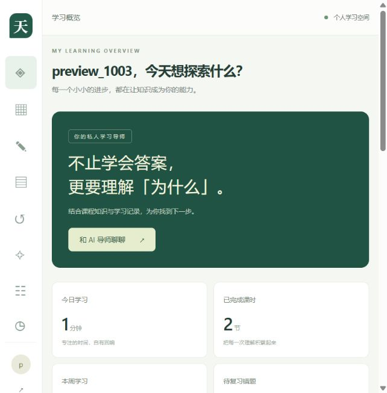

# 验证记录

日期：2026-10-03（Asia/Shanghai）。以下区分实际执行、模拟外部模型与未完成的外部环境联调。

## 实际通过

- Java 17 Maven 多模块编译成功；Spring Boot可执行JAR打包成功。
- 后端自动测试共 **28项**，0失败、0错误。数据库为H2 MySQL兼容模式，真实执行Mapper、SQL迁移与服务事务。
- 18项Spring集成测试使用MockMvc和模拟ChatModel/EmbeddingModel；其中SSE真实经过服务、异步执行器、Spring AI ChatClient与MVC发送流程。
- 3项工具测试经过真实Spring AI ToolCallingManager，验证调用上限、超大并行批次拒绝、工具结果进入后续上下文。
- 7项策略测试覆盖确定性判分、向量相似度、计划验证、Agent步数与AI关闭降级。
- 本地运行后执行 **21个真实HTTP请求**：注册/登录、课程/详情、学习进度、收藏、隐藏答案、练习与错题、考试/提交、防作弊、AI关闭降级、仪表盘、分类、管理员拒绝与教师批改，均通过。
- Vue生产构建成功（依赖升级后再次验证）；官方npm审计 **0 vulnerabilities**。
- 浏览器手动验证登录、课程广场、目录与进度、讲义页面保存到100%、首页统计更新、导师页面未启用AI的正确提示。

| 测试套件 | 测试数 | 失败 | 错误 |
| --- | --- | --- | --- |
| PolicyUnitTest | 7 | 0 | 0 |
| SecurityIntegrationTest | 18 | 0 | 0 |
| ToolBudgetTest | 3 | 0 | 0 |

## 浏览器检查中修复的问题

1. 用户消息没有sources字段，导师组件读取length时崩溃：已改为可选字段检查，实际发送消息复验通过。
2. 窄屏布局隐藏了退出按钮：已保留可访问退出入口。
3. 导航后继承旧滚动位置：加入路由顶部恢复。
4. 初始依赖有3项已知安全公告：更新Axios 1.20.0、Element Plus 2.14.7、Vite 6.4.3，重新构建及审计通过。

## 尚未验证

- **真实MySQL/Redis端到端**：独立MySQL 8.4和Redis测试容器曾成功启动，MySQL健康检查通过；随后发生认证失败、Docker API 500与WSL引擎异常，数据库连接超时。因此未把H2测试称为MySQL测试通过。
- **完整Docker Compose镜像构建与Nginx联调**：配置已提供，但因上述引擎问题未完成运行验收。
- **真实模型服务**：未提供聊天或Embedding密钥，未消耗真实模型额度，未验证DeepSeek/OpenAI远端响应质量。测试模拟模型不代表真实模型效果。
- 未进行压力测试、真实并发数据库基准、RAG命中率评估或全面渗透测试。

## 本次本地预览

当前开发预览使用H2与内存分类缓存，地址为 `http://127.0.0.1:15175`，后端端口18273。它依赖本次启动的本地进程持续运行；重新启动请按README的正常流程使用自己的`.env`。

截图来自真实页面与测试账号，数据由实际操作生成：



## 测试容器清理说明

已尝试仅清理项目 `tianji-academy-qa-1003` 的测试容器和临时卷，但Docker WSL引擎错误使清理未成功确认。没有重启Docker或操作其他项目。

Docker恢复后，可在确认该项目标签后清理本次临时容器：

```powershell
docker ps -a --filter label=com.docker.compose.project=tianji-academy-qa-1003
# 仅当确认这些是本次测试容器后执行：
docker rm -f -v tianji-academy-qa-1003-mysql-1 tianji-academy-qa-1003-redis-1
docker network rm tianji-academy-qa-1003_default
```

该清理只用于本次一次性测试环境，不是用户正式部署的`tianji-ai-academy`项目。
